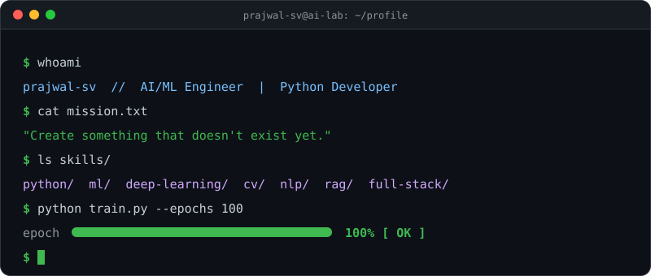
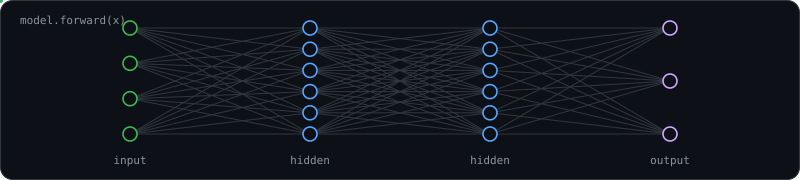
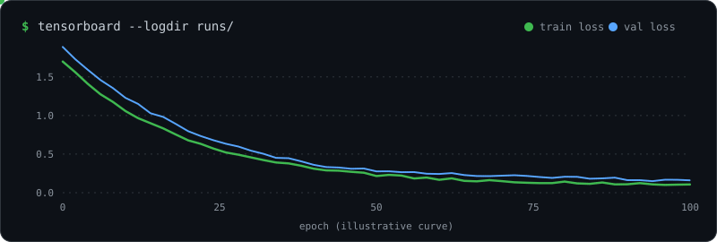
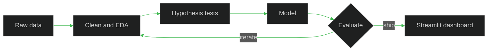

<div align="center">





<br>

<a href="https://www.linkedin.com/in/prajwal-wankhede-22388628a"></a>
<a href="https://leetcode.com/u/prajwal__sv/"></a>
<a href="mailto:prajwalwankhede890@gmail.com"></a>


</div>

```console
$ cat about.md
```

> [!NOTE]
> CS undergrad in **AI & ML** from Nagpur, India. I build scalable apps, turn raw data into decisions, solve DSA on LeetCode, and lead projects that ship.

```console
$ cat now.txt
building   : data and ML projects, end to end (cleaning, EDA, models, dashboards)
exploring  : RAG, NLP and computer vision
practising : DSA on LeetCode
motto      : "Create something that doesn't exist yet."
```

<div align="center"></div>

```console
$ ./neural_net --visualize
```

<div align="center">
  
</div>

<br>

```console
$ tensorboard --logdir runs/
```

<div align="center">
  
</div>

<br>

```console
$ cat how-i-build.md
```



<div align="center"></div>

```console
$ ls skills/
```

<details open>
<summary><b>Languages and AI/ML</b></summary>
<br>
<div align="center">
  
  <br><br>
  
  
  
  
  
</div>
</details>

<details>
<summary><b>Data science, web and tools</b></summary>
<br>
<div align="center">
  
  <br><br>
  
  
  
</div>
</details>

<div align="center"></div>

```console
$ ls -la ~/projects/featured
```

| Project | What it does | Stack |
| :-- | :-- | :-- |
| [**hotel-booking-analysis**](https://github.com/prajwal-sv/hotel-booking-analysis) | Analysis of 119K bookings: cleaning, EDA, 5 hypothesis tests and ranked recommendations to cut cancellations | `Python` `Jupyter` |
| [**mumbai-heat-aq-risk**](https://github.com/prajwal-sv/mumbai-heat-aq-risk) | Streamlit dashboard for 23 Mumbai stations: PM2.5, PM10, temperature, station map and a data-quality page | `Python` `Streamlit` |
| [**AI-Learning-Career-Assistant**](https://github.com/prajwal-sv/AI-Learning-Career-Assistant) | AI-powered smart learning and career assistant | `Python` `Jupyter` |

```console
$ git log --all --since="recent" --stat   # auto-updated every 6 hours
```

<!--RECENT_START-->
| Repo | What it is | Lang | Stars | Updated |
| :-- | :-- | :-- | :-: | :-: |
| [**AI-Learning-Career-Assistant**](https://github.com/prajwal-sv/AI-Learning-Career-Assistant) | AI-Powered Smart Learning & Career Assistant (course-long project) | `Jupyter Notebook` | 1 | today |
| [**UPI_Fraud_Detection**](https://github.com/prajwal-sv/UPI_Fraud_Detection) | Machine Learning based UPI Fraud Detection System using Python and Streamlit. | `Jupyter Notebook` | 2 | today |
| [**Deep-Learning**](https://github.com/prajwal-sv/Deep-Learning) |  | `Jupyter Notebook` | 0 | 3d ago |
| [**mumbai-heat-aq-risk**](https://github.com/prajwal-sv/mumbai-heat-aq-risk) | Streamlit dashboard for 23 Mumbai monitoring stations: latest PM2.5, PM10 and temperature ... | `HTML` | 5 | 13d ago |
| [**Machine-Learning**](https://github.com/prajwal-sv/Machine-Learning) |  This Machine Learning Python Repository serves as a comprehensive, end-to-end curriculum ... | `Jupyter Notebook` | 0 | 14d ago |
<!--RECENT_END-->

<div align="center"></div>

```console
$ gh stats && leetcode stats
```

<div align="center">
  
  <br><br>
  
</div>

<br>

```console
$ ./harvest --commits   # a drone sweeps my real contribution graph
```

<div align="center">
  
</div>

<br>

> [!TIP]
> Working on something with ML, data, or RAG? I'd love to hear about it. The fastest way to reach me is [LinkedIn](https://www.linkedin.com/in/prajwal-wankhede-22388628a) or [email](mailto:prajwalwankhede890@gmail.com).

<div align="center">


<!--SYNC_START-->
<sub>last synced: 2026-11-26 20:51 UTC</sub>
<!--SYNC_END-->

`exit 0`

</div>